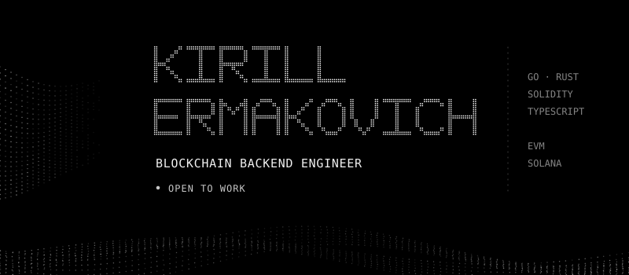
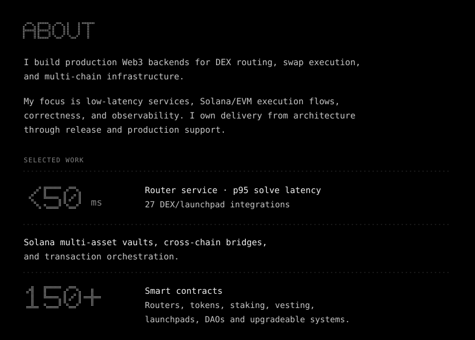
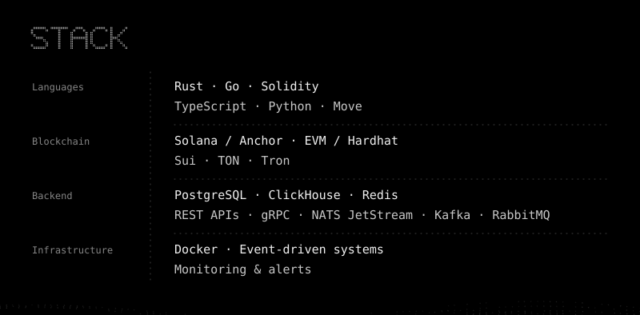
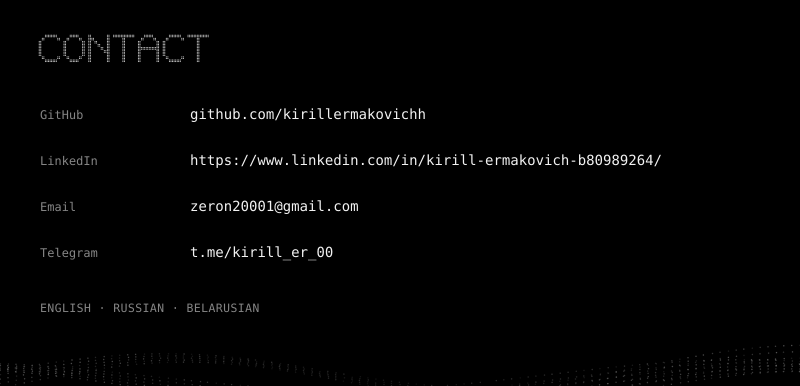

  

  

  

  

  <a href="https://github.com/kirillermakovichh">GitHub</a>
  &nbsp;·&nbsp;
  <a href="https://www.linkedin.com/in/kirill-ermakovich-b80989264/">LinkedIn</a>
  &nbsp;·&nbsp;
  <a href="mailto:zeron20001@gmail.com">Email</a>
  &nbsp;·&nbsp;
  <a href="https://t.me/kirill_er_00">Telegram</a>

Profile in plain text

### Kirill Ermakovich

**Blockchain Backend Engineer · Open to work**

I build production Web3 backends for DEX routing, swap execution, and multi-chain infrastructure.

My focus is low-latency services, Solana/EVM execution flows, correctness, and observability. I own delivery from architecture through release and production support.

**Selected work**

- DEX router service with p95 solve latency under 50 ms and 27 DEX/launchpad integrations.
- Solana multi-asset vaults, cross-chain bridges, and transaction orchestration.
- 150+ smart contracts across multiple networks, including routers, tokens, staking, vesting, launchpads, DAOs and upgradeable systems.

**Development stack**

| Area | Technologies |
|---|---|
| Languages | Rust · Go · Solidity · TypeScript · Python · Move |
| Blockchain | Solana / Anchor · EVM / Hardhat · Sui · TON · Tron |
| Backend | PostgreSQL · ClickHouse · Redis · REST APIs · gRPC · NATS JetStream · Kafka · RabbitMQ |
| Infrastructure | Docker · Event-driven systems · Monitoring & alerts |

**Languages:** English, Russian, Belarusian.

